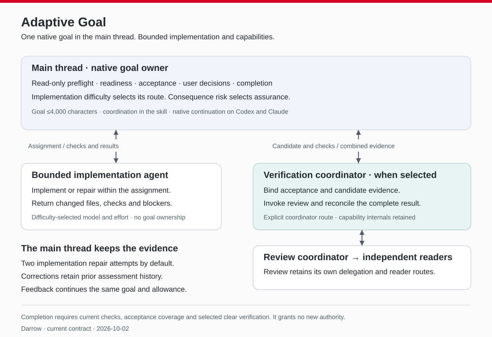

# Darrow Adaptive Goal

Adaptive Goal keeps one bounded native goal in the main thread. That thread
owns preflight, acceptance, user decisions and completion. A route is a model and reasoning effort. The main thread implements directly
when its route matches the selected route. It delegates when the selected route
is stronger, its own route is unknown, or cost, focused ticket context or
concurrency justifies the handoff. The main thread maps each acceptance criterion to current evidence or a gap.
Selected Review owns its workflow, placement and fresh independent readers.

```text
request + repository -> read-only preflight/readiness -> main-thread native goal
                                                         -> direct or delegated implementation
                                                         -> acceptance evidence and selected Review
```

The plugin also provides `doctor-adaptive-goal`, a read-only host-capacity
check. Doctor intent never starts orchestration. Adaptive Goal itself starts
only through explicit invocation or preserved delegation from an invoked recipe.

[](https://github.com/BjRo/darrow/blob/main/docs/assets/adaptive-goal-capabilities.svg)

## `adaptive-goal`

The skill:

- discovers repository instructions and preserves existing local work;
- makes scope, acceptance, checks and authority explicit;
- resolves selected readiness before implementation, reusing ready same-scope evidence;
- selects implementation difficulty separately from consequence risk;
- binds authorized operations to compatible advertised capabilities;
- keeps the native goal within 4,000 characters and coordination instructions in the skill;
- places implementation directly or in bounded assignments;
- accounts for acceptance and invokes independent Review through its public workflow;
- coordinates repairs, user feedback, reassessment and evidence-supported completion.

Readiness findings stop implementation until resolved. Material changes to scope,
acceptance, constraints or authoritative input invalidate affected evidence and
may require readiness again. The main thread retains these decisions throughout.

Each matching advertised skill is mandatory for its bound operation. Direct Git,
forge, tracker or generic-agent calls cannot replace it. Review owns provider coordination, placement and independent readers. The
main thread owns acceptance accounting; no standalone Verification installation
is required. Provider internals stay inside their capabilities.

Ticket delivery discovers local branches using the provider's exact opaque
identifier through a compatible Git capability. One match is reused, several require
an explicit choice, and with no match the caller's exact name is prepared or the
branch-creation capability names one. The recipe supplies authority; Adaptive Goal
chooses and the Git capabilities name and prepare.

## Evidence, risk and model routes

The main thread decides the evidence the change needs: a failing focused check
before changing or adding behavior, a passing baseline before restructuring,
mapped original entrypoints for a sequenced migration, or a complete oracle for
an exact transformation. Missing decisions stop affected work. The implementor
returns changes, check results and blockers; sequencing and delivery bookkeeping
remain with the main thread.

Consequence risk controls assurance. Routine work omits independent review by
default; elevated risk selects it when independent judgment is needed, which
always includes a sequenced consumer or persisted-format transition; high risk
requires it. User or repository requirements can strengthen those gates.

Implementation difficulty controls the bounded implementor:

| Profile      | Codex model | Effort |
| ------------ | ----------- | ------ |
| routine      | gpt-6-luna  | medium |
| routine-plus | gpt-6-luna  | high   |
| scaled       | gpt-6.1-sol | medium |
| repo-wide    | gpt-6.1-sol | high   |
| judgment     | gpt-6-astra | high   |

### Implementation placement

The `placement` helper compares the selected route with the main thread's own
model and effort, observed from the active Codex or Claude session:

| Selected route vs. main thread | Placement                                                                                      |
| ------------------------------ | ---------------------------------------------------------------------------------------------- |
| same                           | implement directly, unless authorized isolated ticket context repays the handoff               |
| higher or unknown              | delegate on the selected route                                                                 |
| lower                          | delegate only when the work is large enough to repay the handoff; otherwise implement directly |

Independent parts with disjoint files and settled interfaces may run as
concurrent assignments within the host's child limit. Coupled work stays
sequential. Ordinary placement preserves assurance: selected Review and other assessments
keep their own routes, and one combined repair consumes one shared attempt
wherever it runs. Expected cost or speed gains are not yet measured claims.

Optional isolated ticket workers receive their own branches and linked
worktrees when fresh context repays the overhead. Bind a finite ticket set and
explicit authority for those effects first. Claude allocates workers through
native `Agent` worktree isolation; Codex uses the bound Git branch/worktree
capability. Claude retains host-chosen paths and branch names without changing
the native sandbox. The main thread keeps the delivery
checkout and cherry-picks returned commits into one integration branch. This
strategy requires owner acceptance accounting and independent Review of the
complete specification after successful combined checks, including routine-risk
work; bind the Review capability before launch. Size or ticket count
alone does not select this strategy. Worker commits grant no publication authority.

A fully specified localized security change can remain routine implementation
while requiring high-risk assurance. `routine-plus` needs an actual implementation
tradeoff or an explicit first-pass correctness priority.

**Use Codex GPT-6.1 Sol/medium for main-thread coordination.** Weaker compatible models
are permitted with a brief hint about coordination and evidence-handling risks.
Stronger compatible configurations are allowed. Model selection alone does not
guarantee reliable coordination or complete evidence.

Independent Review owns its own supported coordinator and reader routes.
Adaptive Goal invokes its public workflow without overriding those routes.
Claude uses the same ownership model; its implementation policy selects scoped
Sonnet 5.5/low, Sonnet 5.5/medium or Opus 5.5/high agents. Claude has lighter
validation than Codex; these routes are not claimed to be measured equivalents.

## Acceptance and repairs

The main thread maps every material criterion to its source, current candidate,
check or independent evidence, supported failure or explicit gap. It supplies
selected Review with the exact candidate, originating acceptance, constraints
and successful current checks, then waits for all selected results. A clear
review alone cannot establish complete acceptance.

The combined conclusion is clear, progress, no-progress or blocked. Missing,
stale, contradictory or unavailable required evidence blocks dependent final
commits, publication and completion. Provider outcomes remain separate and
complete provider reports stay available. No new ledger or controller is added.

The default maximum is **two implementation repair attempts total**, shared
across providers and findings. Each combined repair refreshes checks and requests
closed repair verification through Review's public workflow. The main thread
retains original findings, dispositions, targets, prior results, attempted repairs
and direct-regression lineage. Missing history cannot start a new full review.

Placement is decided once. A repair goes back to the implementor that produced
the candidate, which already holds the task context: the main thread after direct
work, otherwise the retained child through `SendMessage` (Claude) or
`followup_task`/`send_message` (Codex). Only assessment readers start fresh. A
replacement implementor is used only when the retained one is unavailable or no
longer fits the route or scope. Replacement children and comprehensive
reassessment never reset the allowance. Clear evidence ends repair immediately;
further attempts require progress and remaining budget. Explicit finite overrides
and stricter authority, invocation, time or token limits still apply.

An assessment that is itself wrong goes back through that provider's public
correction contract with the concrete error and all prior results. Correction neither spends nor resets implementation repair attempts.

Missing, stale, contradictory or inconclusive required evidence blocks completion
and dependent publication. A passing review alone cannot cover unassessed criteria.

## Safety boundaries

Preflight is read-only. Native goal activation and required readiness precede
implementation. Children receive bounded authority; missing decisions and failed
gates stop affected work. Completion grants no publication or tracker authority.
No nested host, replacement goal owner or custom workflow runtime is introduced.

## Human feedback and blockage

The main thread asks material questions and stops affected mutation. It preserves
the same goal, decisions, evidence and consumed repair attempts while waiting.
The answer supplies only its actual authority; required acknowledgements must
succeed before work resumes. A status question does not cancel work.

Use the host's actual goal controls. On Codex, literal pause requires an explicit
user pause request; a pending question can stop affected work without inventing
a pause transition. On Claude, use native goal question and continuation behavior.
Do not clear and recreate the goal to obtain an answer or reset history.

A blocker names the condition, evidence and smallest next action. Observe current
external state before retrying an ambiguous effect, and never duplicate a completed
effect. Report unavailable delivery or stopping controls honestly.
Every terminal response, including a blocked response after native continuation,
reports repair use and the authorized maximum. Retained evidence of an unchanged
deterministic blocker does not require another execution of the failing command.

## `doctor-adaptive-goal`

The doctor reads effective host delegation controls and distinguishes:

- direct implementation: no child slot;
- delegated implementation: one child slot per concurrent assignment and one
  nesting layer;
- inline assessment: two reader slots and one nesting layer;
- capable-coordinator fallback: three child slots and two nesting layers.

Implementation settles before assessment; the primary is excluded. Provider
prerequisites can require additional capacity.

Native limits that count retained inactive threads may require releasing completed
assignments. Configuration diagnosis does not prove current free capacity or
native goal availability.

Codex checks delegation, concurrent-thread capacity and V1 nesting separately,
including trusted project configuration layers. Isolated evals use their isolated
`CODEX_HOME`. Claude checks version-applicable concurrency and nesting environment
controls. Unknown defaults, unreadable input and inadequate capacity remain distinct.
The doctor changes nothing and prints no unrelated settings or secrets.

## Python helpers

Require UV, Git and the readable packaged project and lock. UV selects compatible
Python; system Python is not a separate prerequisite. The helpers support Python
3.10 to 3.13 on Linux, macOS and Windows without Bash.

Prefix commands with
`uv run --quiet --no-project "<absolute-plugin-root>/backend/scripts/run_locked.py"`:

```text
adaptive-goal-preflight prepare --repo <path> --host <codex|claude>
adaptive-goal-preflight route --repo <path> --host <codex|claude> --profile <profile> [--route <tuple>] [--main-route <tuple>]
claude-agent-route --provider anthropic --model <model> --effort <effort>
host-config-doctor codex --config <path> [--project-root <path>] --backend <v1|v2|unknown> --context <effective|isolated-eval>
host-config-doctor claude [--version <installed-version>]
```

Repository implementation-route overrides live in `.darrow/config.json`.
Malformed or unreadable policy refuses resolution. Claude's resolver checks
scoped-agent frontmatter and conflicting environment overrides; invoke its exact
Agent type without a per-call model override.

`placement` reads only the active session's model and effort: the
`CODEX_THREAD_ID` session file under `CODEX_HOME`, or the
`CLAUDE_CODE_SESSION_ID` transcript under `CLAUDE_CONFIG_DIR` plus
`CLAUDE_EFFORT`. Missing or partial observations report an unknown main route.

Helpers do not launch models, persist objectives, supervise work or implement
goal continuation.

## When to use

Use for an explicitly invoked bounded engineering outcome. Ordinary complex work
does not select it. Use a focused capability when one operation suffices.

## Hosts and prerequisites

Require native goal continuation and delegation, available selected model routes,
UV, Git and capabilities matching authorized operations.

Codex activates the goal in the main thread using native goal controls. Claude
uses native `/goal`; an available `ProposeGoal` may queue activation for the end
of the turn. A queued proposal is not an active goal. Headless Claude may require
the client or user to enter through `/goal <condition>`. If native activation
is unavailable, the skill reports the required boundary rather than launching
another owner or a nested host process.

## Installation

Install `darrow-adaptive-goal@darrow` using the
[host installation instructions](https://github.com/BjRo/darrow/blob/main/docs/installing-plugins.md).

Update the delivery plugins together before starting new work, then open a fresh
session. Preserve active goals and their assessment history. Use the current
`adaptive-goal` and `doctor-adaptive-goal` entrypoints, and remove an older installed
orchestration identity through the host's plugin manager before starting new work.

## Usage

> Use adaptive-goal to fix the intermittent cache test and verify the repair.

Select `adaptive-goal` from Codex's `$` menu, or invoke
`/darrow-adaptive-goal:adaptive-goal` in Claude and provide the request.

For diagnosis, select `doctor-adaptive-goal` or invoke
`/darrow-adaptive-goal:doctor-adaptive-goal`.

## Expected result

A self-contained session response with the outcome, changed files, current
checks, criterion evidence or gaps, selected assessments, repair use and maximum, performed effects and
remaining risks or blockers. A child return or a report link alone cannot prove
completion. Completion grants no commit, push, PR, merge, deployment or ticket
authority.

## Troubleshooting

Resolve non-ready findings before implementation. Report unavailable native goal,
route or capability boundaries concretely. Run the doctor for delegation-capacity
problems and use its reported configuration source. Keep feedback with the same
main-thread goal.

For discovery problems, use the
[installation checks](https://github.com/BjRo/darrow/blob/main/docs/troubleshooting.md).
Report host and plugin versions and the refusal without credentials.

## License

Business Source License 1.1 — see [LICENSE](LICENSE). Converts to MPL-2.0 two
years after each release. Part of the [Darrow](https://github.com/BjRo/darrow)
marketplace.
